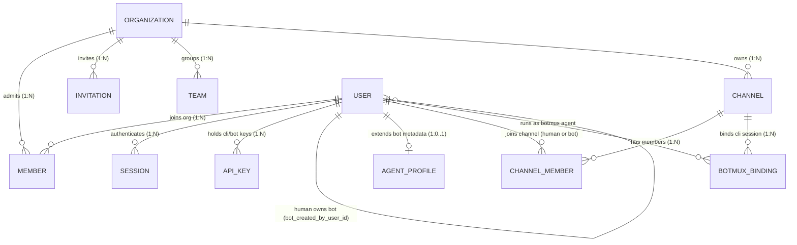

# Bubai Auth（Better Auth）与 Buzz 领域模型对齐设计

本文档定义 `@bubai/auth`、`@bubai/better-auth-bot` 和 `@buzz-botmux/db` 中 Better Auth Drizzle Schema 的架构设计，以及 Bubai 与 Buzz 在 **Community / Channels / Users / Agents** 四个核心概念上的对齐方案。

> 本阶段仅落地后端 auth 包、补丁、Drizzle Schema 与设计文档，**暂不修改现有业务接口**（`apps/server` / `apps/web` / `apps/mobile` 保持现有行为不变）。

---

## 1. Better Auth 插件清单（完整迁移自 `main` 分支）

`@bubai/auth`（[packages/auth/src/index.ts](../packages/auth/src/index.ts)）基于 `better-auth@1.7.26` + Drizzle PostgreSQL/PGlite 适配器，完整保留 `main` 分支的全部 **9 个插件** 与 **2 个补丁**：

| # | 插件 | 来源 | 作用 |
| --- | --- | --- | --- |
| 1 | `bearer({ requireSignature: true })` | `better-auth/plugins/bearer` | 支持 `Authorization: Bearer` 会话令牌（Mobile / API / WebSocket 鉴权） |
| 2 | `emailOtpPlugin` | `better-auth/plugins/email-otp` | 6 位哈希邮箱 OTP 登录与邮箱校验，带一次性邮箱域名拦截（`guardEmailOtp`） |
| 3 | `expo()` | `@better-auth/expo` | Expo Native 移动端 Cookie 同步与 `bubai://` 深链回调支持 |
| 4 | `teamOrganizationPlugin` | `better-auth/plugins/organization` | 组织（Community）+ 子团队（Team）管理，支持可选 `ManagedTeamPolicy` 保护 Bot 托管团队 |
| 5 | `admin({})` | `better-auth/plugins/admin` | 系统级管理员角色、封禁、模拟会话能力 |
| 6 | `bot()` | `@bubai/better-auth-bot` | 在 `user` 表扩展 `kind: 'HUMAN' \| 'BOT'`、`botCreatedByUserId`、`botDisabledAt`，保护 Bot 生命周期字段不被普通账号接口篡改 |
| 7 | `cliDeviceAuthorization` | `better-auth/plugins/device-authorization` | CLI 10 位设备码授权流（`bubai-cli`，5 分钟过期，5 秒轮询） |
| 8 | `apiKey([cli, bot, bot-server])` | `@better-auth/api-key` | 统一签发/校验三类长效密钥（CLI 凭证、`bot_` 密钥、`bot-server_` 密钥） |
| 9 | `cliTokenIssuer()` | `packages/auth/src/cli.ts` | 服务端专用 `redeemCliDeviceCode` 兑换端点 |

### 随迁补丁（`patches/`）
- [patches/better-auth@1.7.26.patch](../patches/better-auth@1.7.26.patch)：限制 Cookie `maxAge <= 400d`（避免 `better-call` 拒收 10 年会话 Cookie），并将 `sendVerificationOTP` 改为 `await` 以便发送失败时向调用方返回明确错误。
- [patches/@better-auth__api-key@1.7.26.patch](../patches/@better-auth__api-key@1.7.26.patch)：保持与 `main` 分支一致的 API Key 行为修复。

### 本地开发与 E2E 登录策略
- **Email OTP 控制台输出**：未传入外部邮件发送器时，默认使用 `createConsoleVerificationEmailSender()`，在服务端控制台打印 `[bubai-auth][dev-otp] type=... email=... otp=...`，无需配置 SMTP/Resend 即可完成完整 OTP 流程。
- **Email + Password 开关**：`emailAndPassword` 在非生产环境默认开启（`process.env.NODE_ENV !== 'production'`），方便本地联调与 E2E 自动化一键注册/登录；生产环境默认关闭，仅开放 Email OTP。

---

## 2. Buzz 与 Bubai 核心概念对齐

引入 Better Auth 的 `organization` + `@bubai/better-auth-bot` 后，Bubai 与 Buzz 的四个核心实体可以直接建立一一映射：

| Buzz 概念 | Buzz 底层实现 | Bubai 对齐目标 | 关键设计点 |
| --- | --- | --- | --- |
| **Community**（顶层租户/工作空间） | `communities(id, host)` | **`organization`**（Better Auth） | 1. 业务表 `channels` 新增 `organization_id` 外键，唯一索引从 `(name)` / `(dm_key)` 改为 `(organization_id, name)` / `(organization_id, dm_key)`； 2. 会话上下文通过 `session.activeOrganizationId` 决定当前 Community； 3. 单机自托管时，首个用户登录自动创建并激活默认 Community，保持开箱即用。 |
| **Users**（人类成员） | `users(community_id, pubkey)` + `relay_members(community_id, pubkey, role)` | **`user(kind='HUMAN')`** + **`member`** + **`invitation`** | 1. 废弃旧 `users` 简表与硬编码 `'u-owner'`； 2. 社区准入、成员角色（`owner / admin / member`）与邀请流直接复用 Better Auth `member` 和 `invitation`。 |
| **Agents**（智能体） | 同在 `users` 表（`agent_type` + `agent_owner_pubkey`），人机同构 | **`user(kind='BOT', botCreatedByUserId)`** + `agent_profiles` + `botmux_bindings` | 1. **对齐 Buzz 人机同表**：每个 Botmux Bot 注册为一条 `user(kind='BOT')`，`botCreatedByUserId` 对应 Buzz 的 `agent_owner_pubkey`，并通过 `member` 加入所属 Community； 2. **保留 Bubai 特色**：`agent_profiles` 存扩展 prompt/描述，`botmux_bindings(channel_id, bot_user_id, session_id)` 维持频道到 Botmux 本地 CLI 终端会话的绑定； 3. 可选在用户偏好表加 `bestie_user_id` 对齐 Buzz 的 Bestie。 |
| **Channels & 成员** | `channels(community_id, id)` + `channel_members(community_id, channel_id, pubkey)` | `channels(organization_id, id)` + `channel_members(channel_id, user_id, role, auto_reply)` | 因为人类与 Agent 统一为 `user.id`，`channel_members` 和 `messages` 可消除 `user_id / agent_id`、`sender_user_id / sender_agent_id` 的双字段割裂，统一为单字段外键指向 `user(id)`。 |

### 目标 ER 关系图

---

## 3. Drizzle Auth Schema（已落地）

已在 [packages/db/src/auth-schema.ts](../packages/db/src/auth-schema.ts) 中落地完整的 Better Auth 表定义与 `AUTH_DDL`（与现有 `schema.ts` 物理隔离，互不冲突）：

- 核心表：`"user"`、`"session"`、`"account"`、`"verification"`
- 组织/社区表：`"organization"`、`"member"`、`"invitation"`、`"team"`、`"team_member"`
- 凭证/设备授权表：`"api_key"`、`"device_code"`

可通过 `@buzz-botmux/db` 导出的 `openAuthDatabase()` 或 `AUTH_DDL` + `authSchema` 直接挂载到 `createAuth()`。

---

## 4. 下一阶段接入业务接口的推荐步骤

后续准备将现有业务接口切到 Auth + 多 Community 时，建议按以下顺序渐进迁移：

1. **挂载 `/api/auth/*`**：在 `apps/server/src/main.ts` 的 Hono 实例上挂载 `app.on(['GET', 'POST'], '/api/auth/*', (c) => auth.handler(c.req.raw))`，并在 `openChatDatabase()` 中合并执行 `AUTH_DDL`。
2. **数据表对齐迁移**：
   - 为 `channels` 增加 `organization_id`（外键指向 `"organization"(id)`），将现有频道回填到默认 Community；
   - 将现有 `u-owner` 与 Botmux Bot 同步到 `"user"`（`HUMAN` / `BOT`）和 `"member"`，并统一 `channel_members.user_id`、`messages.sender_user_id`。
3. **鉴权中间件**：
   - REST 接口通过 `auth.api.getSession({ headers: c.req.raw.headers })` 与 `botCredentials(auth.api).verifyBotKey(...)` 解析当前 `userId` + `organizationId`；
   - WebSocket 握手校验 Session Cookie / Bearer Token，替换掉客户端直传的 `userId`。
4. **前端与移动端接入**：
   - `apps/web` 与 `apps/mobile` 引入 `createAuthClient`（Web 用 `emailOTPClient + organizationClient + adminClient`，Mobile 额外加 `expoClient` + `SecureStore`）；
   - Mobile 的 `connect.tsx` 升级为「选择/扫码服务器地址 → 登录/配对 → 选择 Community」。
