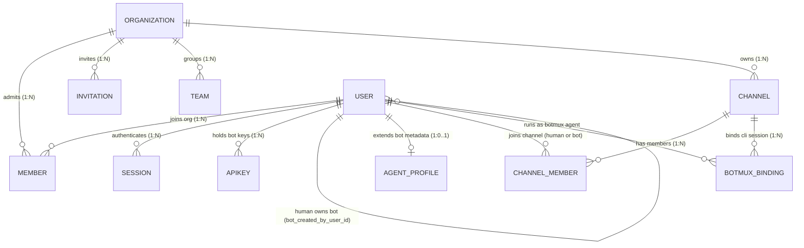

# Bubai Auth（Better Auth）与 Buzz 领域模型对齐设计

本文档记录 `@bubai/auth`、`@bubai/better-auth-bot` 的纯插件配置与自动生成的 Drizzle Schema，以及 Bubai 与 Buzz 在 **Community / Channels / Users / Agents** 四个核心概念上的对齐方案。

> 本阶段仅落地后端 auth 包、插件生成的 Schema 与设计文档，**暂不修改现有业务接口**（`apps/server` / `apps/web` / `apps/mobile` 保持现有行为不变），且**不使用任何 `patches/` 补丁**。

---

## 1. Better Auth 插件清单（纯插件默认配置）

`@bubai/auth`（[packages/auth/src/index.ts](../packages/auth/src/index.ts)）基于 `better-auth@1.7.26` + Drizzle PostgreSQL/PGlite 适配器，按各插件标准配置挂载，不额外叠加自定义 hook 或业务字段：

| # | 插件 | 来源 | 作用 |
| --- | --- | --- | --- |
| 1 | `bearer()` | `better-auth/plugins/bearer` | 支持 `Authorization: Bearer` 会话令牌（Mobile / API / WS） |
| 2 | `emailOTP({ sendVerificationOTP })` | `better-auth/plugins/email-otp` | 邮箱验证码登录（开发态默认打印 OTP 到控制台） |
| 3 | `expo()` | `@better-auth/expo` | Expo Native 移动端 Cookie 与 `bubai://` 深链支持 |
| 4 | `organization({ teams: { enabled: true } })` | `better-auth/plugins/organization` | 组织（Community）+ 子团队（Team） |
| 5 | `admin({})` | `better-auth/plugins/admin` | 系统级管理员角色、封禁、模拟会话 |
| 6 | `bot()` | `@bubai/better-auth-bot` | 在 `user` 表扩展 `kind: 'HUMAN' \| 'BOT'`、`botCreatedByUserId`、`botDisabledAt` |
| 7 | `deviceAuthorization()` | `better-auth/plugins/device-authorization` | 标准设备授权流（供 CLI 等终端登录） |
| 8 | `apiKey([botApiKeyConfig, botServerApiKeyConfig])` | `@better-auth/api-key` | 签发与校验 `bot_` / `bot-server_` API Key |

### Schema 生成方式
- Schema 完全由 Better Auth CLI 按上述插件自动生成，**不手写、不私加业务列**：
  - [packages/auth/src/schema.ts](../packages/auth/src/schema.ts)（通过 `pnpm --filter @bubai/auth auth:generate` 生成，仅对自引用外键补充 `AnyPgColumn` 类型标注以通过 `strict` 编译）
- 共 11 张标准表：`user`、`session`、`account`、`verification`、`organization`、`member`、`invitation`、`team`、`team_member`、`device_code`、`apikey`。

### 本地开发与 E2E 登录策略
- **Email OTP 控制台输出**：未传入外部邮件发送器时，默认使用 `consoleVerificationOTP`，直接在服务端控制台打印 `[bubai-auth][otp] type=... email=... otp=...`。
- **Email + Password 开关**：非生产环境默认开启 `emailAndPassword`（`process.env.NODE_ENV !== 'production'`），方便本地联调与 E2E 自动化。

---

## 2. Buzz 与 Bubai 核心概念对齐

| Buzz 概念 | Buzz 底层实现 | Bubai 对齐目标 | 关键设计点 |
| --- | --- | --- | --- |
| **Community**（顶层租户/工作空间） | `communities(id, host)` | **`organization`**（Better Auth） | 1. 后续业务表 `channels` 增加 `organization_id` 外键，唯一索引改为 `(organization_id, name)` / `(organization_id, dm_key)`； 2. 通过 `session.activeOrganizationId` 切换当前 Community； 3. 单机自托管时，首个用户登录自动创建并激活默认 Community。 |
| **Users**（人类成员） | `users(community_id, pubkey)` + `relay_members` | **`user(kind='HUMAN')`** + **`member`** + **`invitation`** | 1. 取代当前简陋的 `users` 表与硬编码 `'u-owner'`； 2. 社区准入、成员角色与邀请直接复用 Better Auth `member` / `invitation`。 |
| **Agents**（智能体） | 同在 `users` 表（`agent_type` + `agent_owner_pubkey`） | **`user(kind='BOT', botCreatedByUserId)`** + `agent_profiles` + `botmux_bindings` | 1. **对齐 Buzz 人机同表**：每个 Botmux Bot 注册为一条 `user(kind='BOT')`，`botCreatedByUserId` 对应 Buzz 的 `agent_owner_pubkey`，同样通过 `member` 加入 Community； 2. **保留 Bubai 特色**：`agent_profiles` 与 `botmux_bindings` 继续承载扩展 prompt 与本地 CLI 终端会话绑定。 |
| **Channels & 成员** | `channels(community_id, id)` + `channel_members(community_id, channel_id, pubkey)` | `channels(organization_id, id)` + `channel_members(channel_id, user_id, role, auto_reply)` | 人类与 Agent 统一为 `user.id` 后，`channel_members` 与 `messages` 不再需要 `user_id / agent_id`、`sender_user_id / sender_agent_id` 两套并列字段。 |

### 目标 ER 关系图

---

## 3. 下一阶段接入业务接口的推荐步骤

1. **挂载 `/api/auth/*`**：在 `apps/server/src/main.ts` 的 Hono 实例上挂载 `app.on(['GET', 'POST'], '/api/auth/*', (c) => auth.handler(c.req.raw))`，并在数据库初始化时同步 `packages/auth/src/schema.ts`。
2. **业务表对齐迁移**：为 `channels` 增加 `organization_id`，将现有用户与 Botmux Bot 同步到 `user`（`HUMAN` / `BOT`）与 `member`，并逐步统一 `channel_members.user_id`、`messages.sender_user_id`。
3. **鉴权中间件**：REST 与 WebSocket 握手通过 `auth.api.getSession({ headers })` 和 `botCredentials(auth.api).verifyBotKey(...)` 解析身份与当前 `organizationId`。
4. **前端与移动端接入**：Web 与 Mobile 引入 `createAuthClient`（Mobile 叠加 `expoClient` + `SecureStore`），`connect.tsx` 升级为「选择/扫码服务器地址 → 登录/配对 → 选择 Community」。
