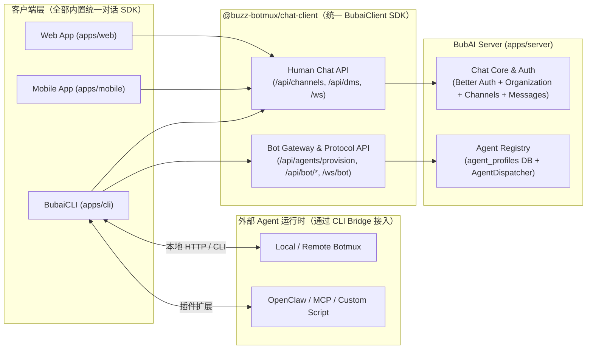

# BubaiCLI + 统一对话 SDK + AgentUser 接入架构方案

本文档定义 **BubAI Server**、**统一对话 SDK（`@buzz-botmux/chat-client`）** 与 **BubaiCLI（`apps/cli`）** 之间的分层边界、协议契约及 Botmux 桥接落地方式。

---

## 1. 核心架构与分层边界

### 关键设计原则
1. **BubAI Server 彻底零耦合外部运行时**：服务端不再强制依赖 `BOTMUX_ENDPOINT`（支持 `BOTMUX_DISABLED=true` 独立运行），只维护标准用户、频道、消息、持久化 Agent 注册表与 `/ws/bot` + `/api/bot/*` 协议。
2. **Web / Mobile / CLI 共享同一套对话 SDK**：三端统一使用 `BubaiClient`（`@buzz-botmux/chat-client`），共享 URL 规范化、Bearer/Cookie 鉴权、JSON 请求封装、WebSocket 自动重连与心跳状态机；在此基础上，SDK 同时提供 Human Chat 接口与 Bot Gateway 接口。
3. **Agent 即成员（AgentUser）**：
   - 每个接入的外部 Agent 在 BubAI 中拥有持久化的 `AgentUser` 身份（`agent_profiles` + 可选 Better Auth `user(kind='BOT')` + `bot_` / `bot-server_` API Key）。
   - `AgentUser` 通过标准的 `channel_members` 加入指定 Channel 后即可收发对话，天然遵循最小权限原则。
   - CLI / Adapter 断开连接只影响实时在线状态（`status: 'offline'`），**AgentUser 永久保留在 DB、成员列表与历史消息中，不会消失**。

---

## 2. 核心接口与协议契约

### 2.1 AgentUser 认领与幂等创建（Provisioning）
- **`POST /api/agents/provision`**（人类或管理端调用）
  - 入参：`{ agentId?, adapterType?, externalId?, name, description?, cliId?, workingDir?, capabilities?, channelId?, channelName?, autoReply?, issueKey?, keyScope?: 'bot' | 'bot-server' }`
  - 幂等性：若已存在相同 `agentId` 或 `(adapterType, externalId)` 的记录，则复用该 Agent（保留用户已编辑的 `displayName` / `systemPrompt` / `avatarUrl`），不重复建号。
  - 可选动作：
    - 若传 `channelId` / `channelName`，自动将该 `AgentUser` 加入对应 Channel（并设置 `autoReply`）。
    - 若传 `issueKey: true` 且 Better Auth 启用，签发对应的 `bot_` 或 `bot-server_` Key。
- **`GET /api/agents`**：返回 DB 中所有已知 Agent 及其合并后的实时在线状态（`online` / `offline`）、`adapterType`、`capabilities`。

### 2.2 统一 SDK（`BubaiClient`）新增 Bot 能力
- REST 方法：
  - `provisionAgent(input)` / `listAgents()`
  - `registerBotAgents(agents)` / `sendBotHeartbeat(input)`
  - `sendBotMessage(input)` / `updateBotMessage(messageId, patch)` / `sendBotProgress(messageId, progress)`
  - `createBotAsk(input)` / `getBotChannelMessages(channelId, opts)`
- WebSocket Gateway 方法：
  - `connectBotGateway(options)`：连接 `/ws/bot`，自动发送 `bot.hello`、维护 25s `bot.ping` 心跳与断线重连，回调 `onTurnRequested(event)` 与 `onAskAnswered(event)`，并提供 `sendTurnProgress` / `sendTurnComplete` / `sendPresence` / `createAsk`。

### 2.3 防回环与触发规则
- 服务端仅对 **人类发送的消息** 触发 Agent 路由，且满足以下任一条件才派发 `turn.requested`：
  1. 消息显式 `@mention` 了该 Agent（匹配 `name` / `defaultName` / `id`）；
  2. 该 Agent 在当前 Channel 的 `channel_members.autoReply === true`（包括 DM 自动开启）。
- Bot 自身通过 `/api/bot/messages` 或 `bot.turn.complete` 发出的消息不会再次触发 Agent 路由，从根源杜绝 Bot 互聊死循环。

---

## 3. BubaiCLI（`apps/cli`）命令设计

| 命令 | 说明 |
| :--- | :--- |
| `bubai config set --server <url> [--token <token>]` | 保存 BubAI Server 地址与凭证到 `~/.bubai/config.json` |
| `bubai status` | 检查 BubAI Server 连通性与已注册 Agent 列表 |
| `bubai agent create --name <name> [--id <id>] [--channel <ch>] [--auto-reply]` | 创建/认领持久化 `AgentUser` 并可选加入 Channel |
| `bubai agent list` | 列出 BubAI 中所有持久化 Agent 及其在线/离线状态 |
| `bubai agent join --agent <id> --channel <ch> [--auto-reply]` | 将指定 `AgentUser` 加入 Channel |
| `bubai bridge botmux [--server <url>] [--token <token>] [--botmux <url>] [--channel <ch>] [--auto-reply]` | 拉取本地 Botmux Bot，自动认领为 BubAI `AgentUser`，可选加入 Channel，并通过 SDK `/ws/bot` 双向桥接对话 |
| `bubai chat send --channel <ch> --text <msg> [--bot <id>]` | 通过内置 SDK 向 Channel 发送消息 |

---

## 4. E2E 验证矩阵（`tests/e2e/bubai-cli-bridge.e2e.test.ts`）

在 `BOTMUX_DISABLED=true`（BubAI Server 完全不直连 Botmux）的前提下，拉起真实 BubAI Server + Fake Botmux Daemon + 真实 `BubaiCLI` 子进程，覆盖 4 个核心端到端场景：
1. **幂等认领与入群**：CLI 创建/认领 `AgentUser`，重复执行返回同一 `agentId`；加入 Channel 后在 `bootstrap.participants` 与 `channel_members` 中可见。
2. **双向实时对话（`@mention`）**：启动 `bubai bridge botmux` 后 Agent 变为 `online`；人类通过 `BubaiClient` `/ws` 发送 `@Agent` 消息 → Server 推 `turn.requested` 至 CLI → CLI 调 Botmux 执行并回传结果 → 占位卡片结算为 `completed`。
3. **频道 `autoReply` 无需 `@` 自动响应**：人类发送不带 `@` 的普通消息 → CLI 收到 `turn.requested` 并完成回复。
4. **CLI 断连后离线保留（不消失）**：终止 `bubai bridge botmux` 进程 → Agent 在 `bootstrap.participants` 中仍保留且 `status === 'offline'`；此时 `@Agent` 返回明确的 `dispatch_failed` 离线提示，不挂死。
